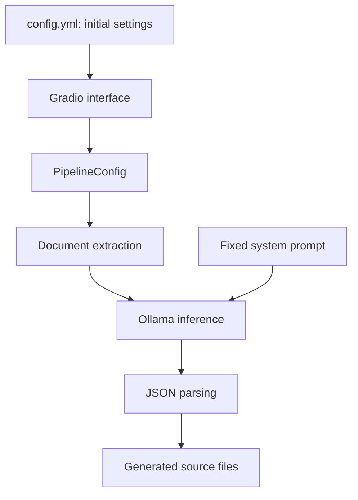

# AI Code Generator

**A simple, general-purpose code generation pipeline powered by Python, Gradio, and local language models through Ollama.**

## 1. Overview

AI Code Generator is an educational project developed for the 20-hour **Creación de Aplicaciones con IA Generativa** (*Generative AI Application Development*) course. It shows how to connect a graphical interface, configuration values, document context, a local language model, and structured output to create source-code files.

The pipeline is intentionally **language-agnostic**: it can request code for different programming languages and application types. HTML/web and Flutter were explored during the course. However, successful generation depends on the local model and task complexity; compatibility with every language is not guaranteed.

**This is a learning resource, not a production-ready coding agent.** Its focus is a readable, end-to-end workflow that learners can adapt.

## 2. Features

- Gradio interface for model selection by name, inference settings, document path, output directory, and generation prompt.
- Initial UI settings loaded from `config.yml`.
- Document text extraction to provide additional context for code generation.
- Local inference using Ollama with a fixed system prompt requesting a JSON response.
- JSON parsing and creation of project directories and generated source-code files.
- Independent teaching utilities for inspecting Ollama models and tokenising text.

## 3. Architecture



The application follows three main phases: **configuration**, **inference**, and **post-processing**.

```text
python-generative-ai-code-generator/
├── main.py                    # Gradio interface
├── pipeline.py                # Main pipeline and output processing
├── constants.py               # Custom CSS and fixed system prompt
├── config.yml                 # Initial interface values
├── models/
│   └── pipeline_config.py     # Configuration data model
├── utils/
│   ├── file_utils.py          # Document, output file, and YAML utilities
│   ├── ollama_utils.py        # Ollama inference and API examples
│   └── utils.py               # Optional tokenisation exercise
├── requirements.txt
└── README.md
```

## 4. Requirements & Installation

**Tested environment:** Python **3.14.5** on Windows, with these Python dependencies:

| Package | Tested version |
|---|---|
| `gradio` | `6.32.0` |
| `ollama` | `0.6.3` |
| `requests` | `2.34.2` |
| `httpx` | `0.28.1` |
| `PyYAML` | `6.0.3` |
| `tiktoken` | `0.14.0` |
| `officeparserpy` | `1.0.10` |

Install [Ollama](https://ollama.com/download) separately and ensure its local service is running. The Python `ollama` package is a client, **not** the inference server.

Clone or download the repository and, from its root, create a virtual environment:

```bash
python -m venv .venv
```

Activate it on Windows PowerShell:

```powershell
.\.venv\Scripts\Activate.ps1
```

Or on macOS/Linux:

```bash
source .venv/bin/activate
```

Install the requirements and download a model suitable for your hardware:

```bash
python -m pip install -r requirements.txt
ollama pull granite4.1:8b
ollama ls
```

The model shown is the course's example configuration. Use an **installed model that fits your machine**. Other Python versions and platforms have not been systematically tested.

## 5. Configuration & Usage

Edit `config.yml` to provide the initial Gradio values:

```yaml
model: "granite4.1:8b"
temperature: 0.2
context_length: 16384
output_path: "C:/path/to/generated_code"
file_path: "C:/path/to/document.pdf"
```

Replace the example paths with real locations. Use a **dedicated, disposable output directory**. Larger context settings may consume more memory. Changes made in Gradio **do not automatically update** the YAML file; edit `config.yml` and restart the application to change its defaults.

Start the application:

```bash
python main.py
```

Open the local URL displayed by Gradio, then:

1. Select the model by entering its name and adjust **Temperature** and **Context length**.
2. Set the **Output directory** and **Input document path**.
3. Describe the requested application in **Generation prompt**.
4. Click **Run pipeline** and inspect the destination folder and terminal output.

For a first demonstration, use a short document and request a small HTML application. The interface does not yet provide an execution progress indicator or completion notification.

## 6. Implementation Notes

- **Gradio — `main.py`:** `Blocks` creates the interface and the button passes component values to `pipeline()` in the order specified in `inputs`.
- **Configuration — `pipeline_config.py`:** `PipelineConfig` groups the positional inputs into named attributes. If the input order changes, the parameter mapping must be updated.
- **Context — `file_utils.py`:** the selected document is read as bytes and its text is extracted using `officeparserpy` before being included in the request. Extraction quality depends on the document; image-only PDFs may require OCR.
- **Inference — `ollama_utils.py`:** the Python client sends the fixed `Constants.SYSTEM_PROMPT` and the user's prompt plus document context. The system prompt is controlled by the developer in `constants.py`, **not editable from Gradio**. The main pipeline uses non-streaming JSON output.
- **Post-processing — `pipeline.py`:** the JSON is parsed and the `code` entries are written as source-code files.

The expected response structure is:

```json
{
  "id": "sample_app",
  "code": [
    {
      "path": "src",
      "file_name": "main.py",
      "content": "print('Hello, world!')"
    }
  ]
}
```

The fixed system prompt expresses the required structure, but a model may still return invalid or unexpected content. **Valid JSON does not automatically mean valid fields or functional code.**

**Additional learning utilities:** `ollama_utils.py` also demonstrates `/api/tags` and `/api/show` for listing and inspecting installed models through the console. `utils.py` illustrates tokenisation with `tiktoken`/`cl100k_base`; its token counts are **not necessarily equal** to those of the selected Ollama model. These utilities are not integrated into the Gradio workflow.

## 7. Limitations & Safety

This project deliberately omits production-level safeguards:

- **Unverified generated code:** output can contain errors, incomplete functionality, or unsafe operations. Review all files before execution or deployment.
- **Limited JSON validation:** parsing does not comprehensively check mandatory keys, data types, schema completeness, or code correctness.
- **File-system risks:** model-generated paths are not constrained to the chosen destination; unexpected directories, path traversal, and overwrites are possible. Run the tool only in a controlled environment and use a disposable folder with no important files.
- **Simple filename handling:** filenames containing multiple periods may not be processed as intended.
- **Basic error handling:** failures may appear in the terminal without a clear interface message.
- **Hardware/model limits:** small local models may struggle with complex code generation or structured output; long documents may exceed the context window.
- **Document extraction:** results depend on format and content; no general OCR, chunk retrieval, or RAG system is implemented.

Do not run unreviewed generated code or use untrusted documents in an environment with sensitive data. The intended setting is **supervised local experimentation**.

## 8. Future Improvements

These are **optional extensions**, not existing features:

- Populate a Gradio model dropdown dynamically using Ollama's `/api/tags` endpoint.
- Add execution feedback, progress indicators, and clearer error messages.
- Allow optional system-prompt configuration through the interface.
- Validate JSON fields and data types, restrict output paths, and handle filenames more robustly.
- Implement model-aware context budgeting and document chunking.
- Add automated checks for generated projects.

These capabilities were left outside the introductory 20-hour course to keep the example focused and understandable.

## 9. Versioning & License

**Suggested initial release:** `v0.1.0` (educational prototype). The project's actual Git tags and GitHub Releases, once published, define its released versions. Future changes may follow [Semantic Versioning](https://semver.org/): major for incompatible changes, minor for added capabilities, and patch for fixes.

**License:** Not yet selected. Until a license is explicitly added, do not assume that public availability on GitHub grants permission to reuse or redistribute the code. If a license is chosen later, include its full text in a `LICENSE` file and update this section.

## 10. Author & Acknowledgements

**Manuel Bacallado** — University Lecturer and PhD Researcher at the University of La Laguna (ULL), Spain.

Developed as a practical educational resource for the **Creación de Aplicaciones con IA Generativa** course within the **Capacita** programme. The project uses Python, Gradio, Ollama, and supporting open-source libraries to illustrate a basic local generative AI pipeline.
